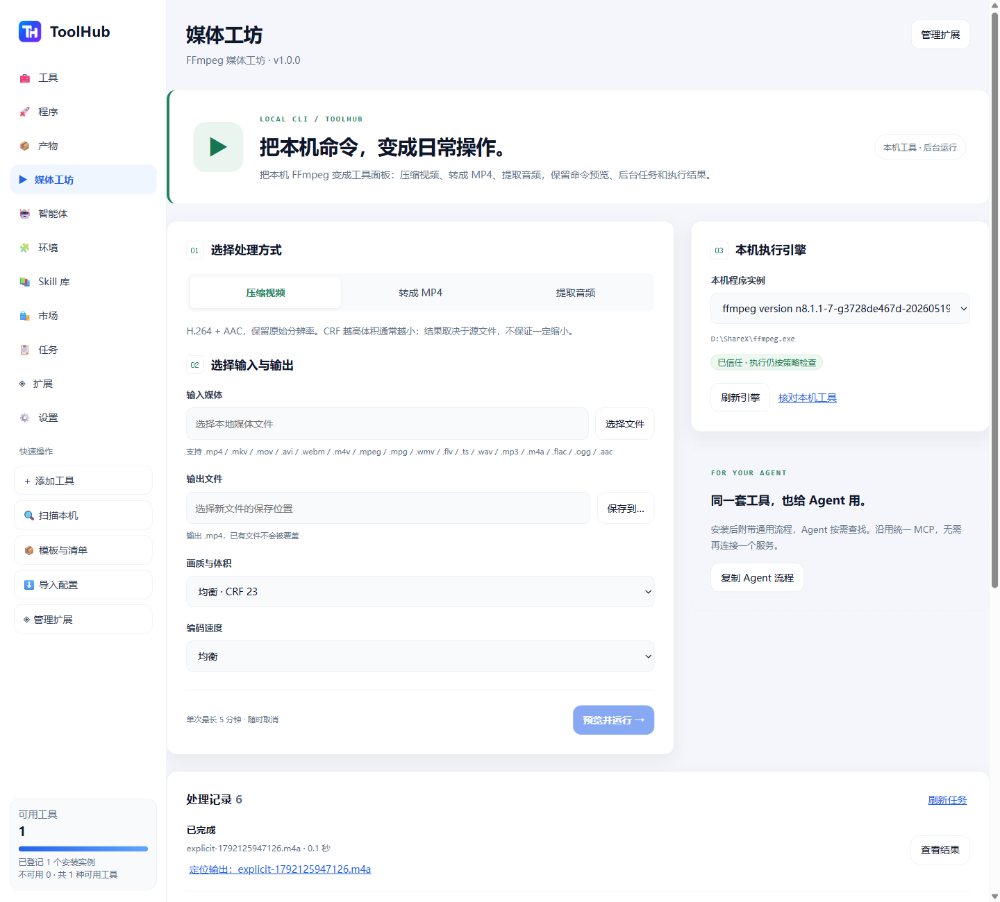
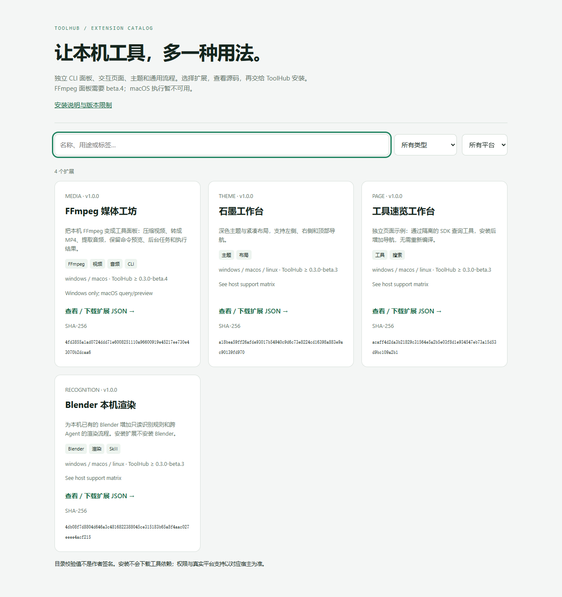
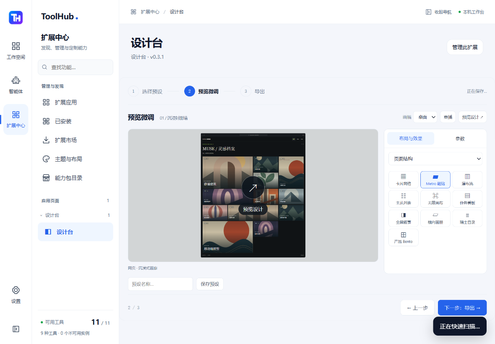
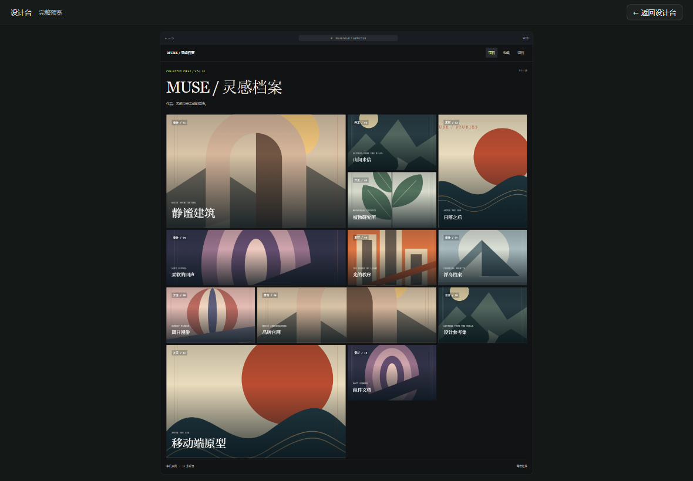

# ToolHub 扩展目录

**简体中文** | [English](README.en.md)

给本机工具加上可安装的操作面板，把页面、主题和可复用流程独立分享。扩展源码与 ToolHub 核心分开维护，按类型、平台与用途筛选；不需要把每个扩展都做成一个 MCP 服务。

ToolHub 主项目：[xiyuxiao1314/ToolHub](https://github.com/xiyuxiao1314/ToolHub)。本目录为初始预览，尚不提供账号、签名发布、自动更新或付费插件。

## 界面预览

截图来自独立 Windows beta.4 验收，使用合成媒体和测试注册表。

## 选择扩展

在 [Releases](https://github.com/xiyuxiao1314/ToolHub-Extensions/releases/tag/design-studio-v0.2.0) 下载单独的设计台包或完整源码目录 ZIP；主程序下载请到 [ToolHub Releases](https://github.com/xiyuxiao1314/ToolHub/releases)。两仓库独立版本化，不需要每次更新插件都重新安装主程序。

下载仓库 ZIP 并解压后，可直接用浏览器打开 [index.html](index.html)，按分类、平台、名称与标签筛选；打开包的 JSON 文件并保存，再到 ToolHub **扩展 → 导入扩展包 → 核对内容 → 确认安装**。GitHub 页面上的 index.html 是源码预览，网页托管未自动启用。

| 扩展 | 用途 | 最低 ToolHub | 平台说明 |
| --- | --- | --- | --- |
| [AI 提示词](packages/ai-prompts/1.1.0/ai-prompts.toolhub-extension.json) | 离线搜索、增删改、Markdown 导入、单条及整库预设导出 | 0.3.0-beta.8 | Windows 保存/导入/重载已验；原生保存对话框待人工验收；macOS 未验 |
| [设计台](packages/design-studio/0.3.1/design-studio.toolhub-extension.json) | 组合布局、导航、效果，生成匹配的 JSON/HTML/Agent 说明，保存设计预设 | 0.3.0-beta.7 | Windows 已验收；macOS 交互未验收 |
| [FFmpeg 媒体工坊](packages/ffmpeg/1.0.0/ffmpeg.toolhub-extension.json) | 压缩视频、转成 MP4、提取 M4A 音频；附通用 Agent 流程 | 0.3.0-beta.4 | Windows 受控执行；macOS 仅预览/查询 |
| [石墨主题](packages/graphite/1.0.0/graphite.toolhub-extension.json) | 配色、布局与紧凑密度 | 0.3.0-beta.3 | 随宿主支持；实体 Mac 未验收 |
| [工具速览](packages/workspace/1.0.0/workspace.toolhub-extension.json) | 独立查询页面、受限 SDK 示例 | 0.3.0-beta.3 | 随宿主支持 |
| [Blender 本机渲染](packages/blender/1.0.0/blender.toolhub-extension.json) | 本机识别规则与跨 Agent 渲染流程 | 0.3.0-beta.3 | 工具依赖需要自行准备 |

**宿主版本提醒：** CLI 面板需要 beta.4；设计台 0.3.1 需要 beta.7 的完整窗口显示接口（本轮本地开发版）；已发布的 0.2 需要 beta.6 包专属预设存储。beta.5 不包含该接口，请使用匹配版本并以每项 min_toolhub_version 为准。设计台 0.2.0 与配套 [ToolHub beta.6](https://github.com/xiyuxiao1314/ToolHub/releases/tag/v0.3.0-beta.6) 分别发布；目录收录不等于每个平台都经过交互验收。

## AI 提示词（1.1.0 本地开发版）

48 条原创模板，支持搜索、分页、全文复制，也可以直接新增、编辑、删除并撤销。导入 UTF-8 Markdown 文本；单条导出为 .md，全部导出为可分享的 JSON 预设包，导入前预览并选择重复条目的处理方式。需要配套 beta.8 宿主；当前为本地开发版，原生保存对话框待人工验收，已更新本机正式运行版。详见 [使用与验证说明](docs/AI-PROMPTS.md)。

## 设计台（0.3.1 本地开发版）

按“选择预设 → 预览微调 → 导出”三步使用，可选无预设或继续草稿。从 12 个可视设计方向开始，组合 10 类布局、4 类导航、5 类视觉语言、封面/字体/摘要内容及展开/悬停/错峰/拖拽/吸顶/焦点效果。参考 Godly、Siteinspire、Awwwards、Codrops 与 Folia，提供多种明显不同的预览；Android / Web / 桌面的外壳和重排随平台切换。点击“预览设计”打开覆盖整个 ToolHub 的完整画面，外框不再滚动，返回后继续分组微调；同步输出严格配置 JSON、可运行 HTML 与 Agent 设计说明。支持最多 24 个本机自定义预设、JSON 备份导入和性能组合约束；不安装第三方 UI 库，不执行导入代码。虚拟列表实际只挂载视口与缓冲区，画布支持相机与视口裁剪。参阅 [完整说明](docs/DESIGN-STUDIO.md)。

可编辑源码在 packages/design-studio/0.3.1/src；在版本目录运行 `python build.py --source src --output design-studio.toolhub-extension.json` 可重建相同包。重新发布时提高版本并更新校验值。

## FFmpeg 媒体工坊

安装后增加“媒体工坊”导航。选择本机 FFmpeg、输入媒体与新的输出位置，设置画质/编码速度或音频码率，预览完整参数，再点击“确认并运行（本次授权）”。后台任务支持状态、耗时、取消、结果日志与定位输出。取消或失败可能留下不完整文件，程序不会自行删除。

不捆绑、不安装 FFmpeg。请先在 ToolHub 工具页扫描或添加已有程序，并核对信任。示例使用 libx264 与 AAC；不同 FFmpeg 构建的编码器可能不同，缺少时会报告原始错误。默认保留源文件并拒绝覆盖已有输出；压缩不保证体积一定变小，最长执行时间 5 分钟。当前不提供百分比进度、批量转码、联网媒体或内嵌终端。

Agent 可按需 search_skills / inspect_skill 获取随扩展发布的流程，沿用 ToolHub 原有 16 个 MCP 元工具与执行策略；无需加载所有扩展正文。Agent 不会获得桌面 controller 身份，宿主专属技能也不会因此共享给其他 Agent。

## 来源与完整性

[catalog.json](catalog.json) 包含分类、标签、平台、版本、最低宿主版本、相对包路径和原始文件 SHA-256；[SHA256SUMS.txt](SHA256SUMS.txt) 可离线核对。文件字节校验值与 ToolHub 解析规范化后的安装摘要用途不同，不要混用。

校验值用于检测文件变化，不是发布者签名。安装前始终查看作者、依赖、源码和权限。扩展中的说明不构成用户授权。脚本页面仍运行在隔离框架；CLI 贡献由可信核心渲染，仅执行用户核对过的操作，不向 iframe 开放任意执行。

## 贡献与验证

参阅 [CONTRIBUTING.md](CONTRIBUTING.md) 和主项目 [扩展开发文档](docs/CLI-CONTRIBUTIONS.md)。尚未合并到主分支的接口以匹配的宿主开发版本为准。修改版本目录中的 manifest，运行 `python scripts/validate.py`；更新 catalog.json、catalog.js 和 SHA256SUMS.txt，校验失败时不要发布。提交真实平台验证结果，不承诺未测试的平台。

采用 [MIT](LICENSE)；不包含 FFmpeg、Blender 或其他工具二进制，它们有各自许可证。

[Verification / 验证记录](docs/VERIFICATION.md) · [CLI contribution contract](docs/CLI-CONTRIBUTIONS.md)

