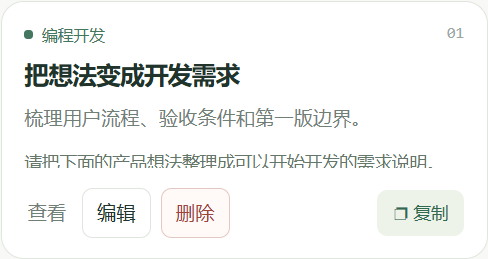

# AI Prompts 1.1.1 · 卡片管理入口

原先删除入口只在详情中，编辑也需要先打开卡片，用户难以发现。1.1.1 在每张卡片上直接显示「查看」「编辑」「删除」「复制」，删除用红色按钮标识；顶部突出「新增提示词」。删除保留确认、取消和撤销；数据格式和权限不变。保留 1.1.0 原始版本目录，目录与校验值指向 1.1.1。

2026-10-22 Windows ToolHub beta.8 独立数据库/WebView 验证：

- 新增并保存；从卡片直接编辑；重新加载后内容保留。
- 从卡片直接打开删除确认，详情仍关闭；确认前和取消后数据不变。
- 确认删除；撤销恢复相同内容和位置；详情内删除仍可用；重载后删除生效。
- 1440×900、1100×760、900×640 的窗口尺寸下，卡片操作没有溢出，页面保留分页。
- 模型往返/容量/冲突策略测试，以及目录元数据和 SHA-256 校验通过。

本机正式版通过标准 extension.preview / extension.install 流程升级到 1.1.1，核对其他 10 个扩展摘要、启用状态及外观偏好不变；提示词存储原值不变。正式页已实点卡片编辑与删除确认，取消后保留原始提示词，没有写入验收条目。

原生导出保存窗口与 macOS 实机仍未在本次验证。当前变更未上传 GitHub。

回归脚本：`scripts/verify-ai-prompts-cards.mjs`。先启动安装此扩展的独立 ToolHub 测试实例，指定 `TOOLHUB_PROMPT_QA_REGISTRY` 和可选的 `TOOLHUB_PROMPT_QA_CDP`，再运行脚本；Playwright 可从本地依赖解析，也可用 `TOOLHUB_PLAYWRIGHT_MODULE` 指定模块地址。脚本拒绝默认用户数据库，在隔离库中创建、修改并删除临时条目。
