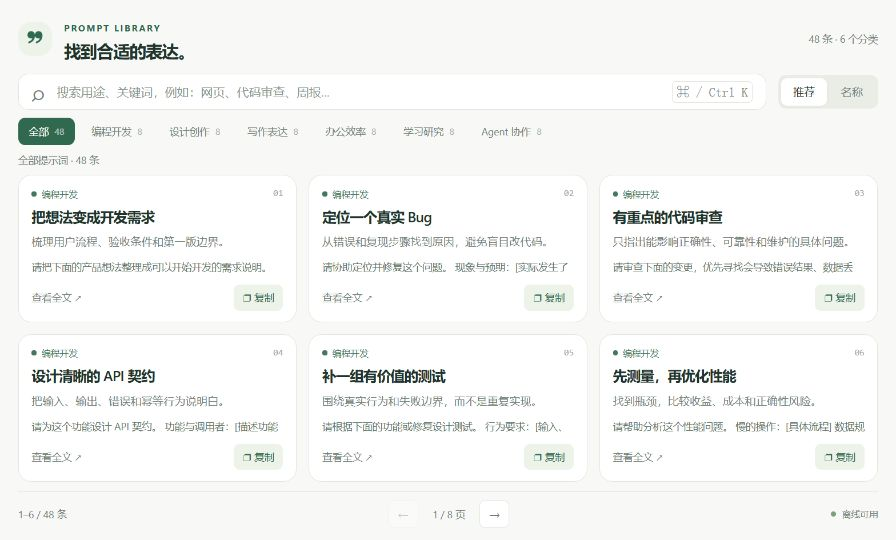

# AI Prompts

`community.ai-prompts` 1.0.0 is a small offline page extension for ToolHub beta.3 or newer. It contains 48 original templates in six categories: development, design, writing, office work, learning and Agent collaboration.

Use category buttons or keyword search, open the full text, and copy it into your AI tool. Replace bracketed placeholders as needed. Pagination follows available space; Ctrl/Command+K focuses search and Escape closes details. If browser copying is unavailable, the complete text is selected for manual copying.

There are no accounts, favorites, publishing, ratings, comments, model calls or network access. The extension requests no ToolHub permissions and contributes no Skills. Prompt text does not grant execution authority. No ToolHub host changes are required.

Install [the package](../packages/ai-prompts/1.0.0/ai-prompts.toolhub-extension.json), then open **Extension Center → Applications → AI Prompts** (the page label is currently Chinese). Editable sources and a standalone `preview.html` are included in the version directory. Run `python packages/ai-prompts/1.0.0/build.py` to rebuild.

Windows Edge sandbox interaction, native host parsing/installation and existing inventory preservation were checked. This is not a macOS interaction claim. The Chinese guide contains detailed scope, evidence and limitations. No GitHub Release has been created for this local delivery.

The interface concept was informed by [AI Short's guide](https://www.aishort.top/docs/guides/interface); its content, source code and service are not copied or synchronized. Templates are original to this project and distributed under MIT.

