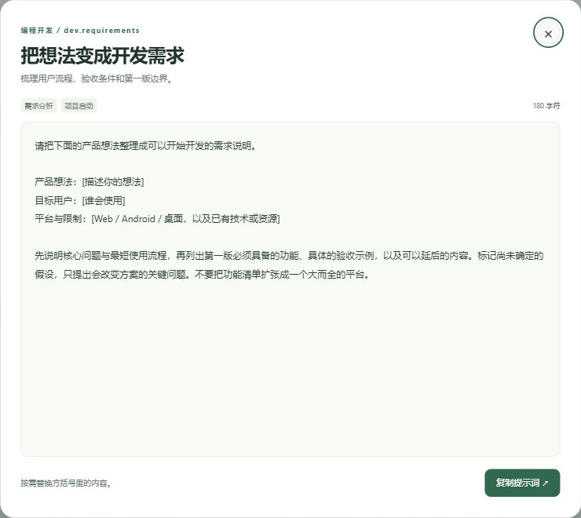

# AI 提示词

独立扩展 `community.ai-prompts` 1.0.0，需要 ToolHub 0.3.0-beta.3 或更新版本。目标是一个简单的提示词模块，不是在线社区：不包含账号、收藏、发布、点赞或评论。

## 使用

安装后在「扩展中心 → 扩展应用 → AI 提示词」打开，也可固定到工作空间。

- 48 条原创通用文本模板，分为编程开发、设计创作、写作表达、办公效率、学习研究和 Agent 协作六类。
- 点击分类按钮或输入关键词；搜索标题、用途、标签和正文，多关键词同时匹配。可按推荐顺序或名称排列。
- 列表按可用窗口尺寸分页；点击「查看全文」打开独立弹窗，点击「复制」取得完整提示词。按需替换方括号里的内容后再发送给 AI。
- Ctrl+K / Command+K 聚焦搜索；Escape 关闭全文，焦点返回来源按钮。
- 复制使用用户点击触发的浏览器复制操作；环境不支持时显示已选中的全文并提示键盘复制，不会假报成功。

所有内容都包含在扩展包内。无网络、文件、执行或 ToolHub 查询权限，不读取工具库，不自动调用模型，不把提示词登记成 Skill，不保存输入内容。提示词只是可复制文本；不会赋予任何 Agent 额外权限。分类计数是搜索范围内的条目数量，不是社区活跃度或效果评分。

## 来源与编辑

功能参考 [AI Short 界面指南](https://www.aishort.top/docs/guides/interface)。本包不复制或同步 AI Short 的提示词、账号、数据或源码。48 条模板为本项目原创，随仓库使用 MIT 许可证。

可编辑内容在 `packages/ai-prompts/1.0.0/src/prompts.json`；界面源文件、manifest 和构建脚本同目录提供。增加内容时保持 ID 唯一，更新分类并遵守模板数据及 ToolHub 单包/单页的大小限制。

```powershell
python packages/ai-prompts/1.0.0/build.py
python scripts/register-ai-prompts.py
python scripts/validate.py
node scripts/preview-ai-prompts.mjs
```

预览地址为 `http://127.0.0.1:19344/sandbox`，使用与 ToolHub 页面相同的 `sandbox="allow-scripts"` 约束；仅绑定回环地址，不提供目录、文件选择器或 RPC。也可直接打开包目录里的 `preview.html`。编辑已公开版本时应发布新版本，不能静默覆盖。

构建完全离线；HTML、CSS、JS 和总包会检查原有大小上限。本轮不修改 ToolHub 核心、SDK、MCP 工具或注册库 schema。原有扩展与用户库数据应在安装前后比对。

## 验证状态

已通过 Windows Edge 隔离页面与 ToolHub 原生宿主的正式预览/安装接口验证。宿主生成的实际扩展文档已确认能加载和复制；这不等同于 macOS 或其他原生 WebView 的实机交互验收。当前未发布 GitHub Release。

- 896×540：六卡片分页，六类各八条；分类、搜索、空态、重置、名称排序和末页禁用状态通过。
- 390×620 和 680×420：随尺寸调整每页容量，页脚可见，body 的滚动宽高与可视宽高一致。
- 卡片和全文的复制均显示真实成功反馈；全文只读；Escape 恢复来源按钮焦点，弹窗 Tab / Shift+Tab 循环和 Ctrl+K 搜索通过。
- 正式安装后原有 10 个扩展的摘要、启用状态及外观偏好一致；47 个工具实例、7 个程序、3 个 Skill 和 1 个产物包保持不变，启动扫描仅刷新工具时间戳。
- 数据及构建检查通过，生成包 56,373 字节；重复构建应产生相同原始 SHA-256。

浏览器日志出现没有应用堆栈的连接提示（`Receiving end does not exist`），因此本记录不作“浏览器日志零错误”的断言；上述实际功能均完成验证。macOS 实机尚未验证；输入搜索内容不跨页面保留。



